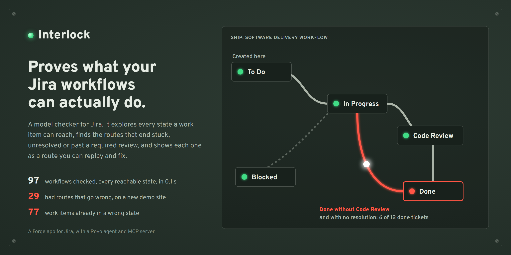
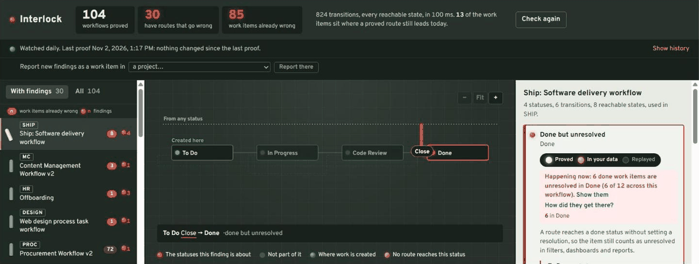
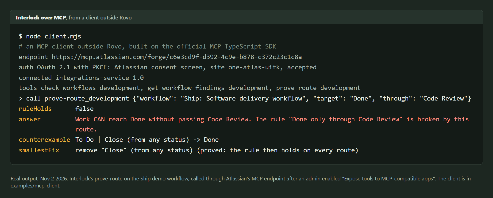
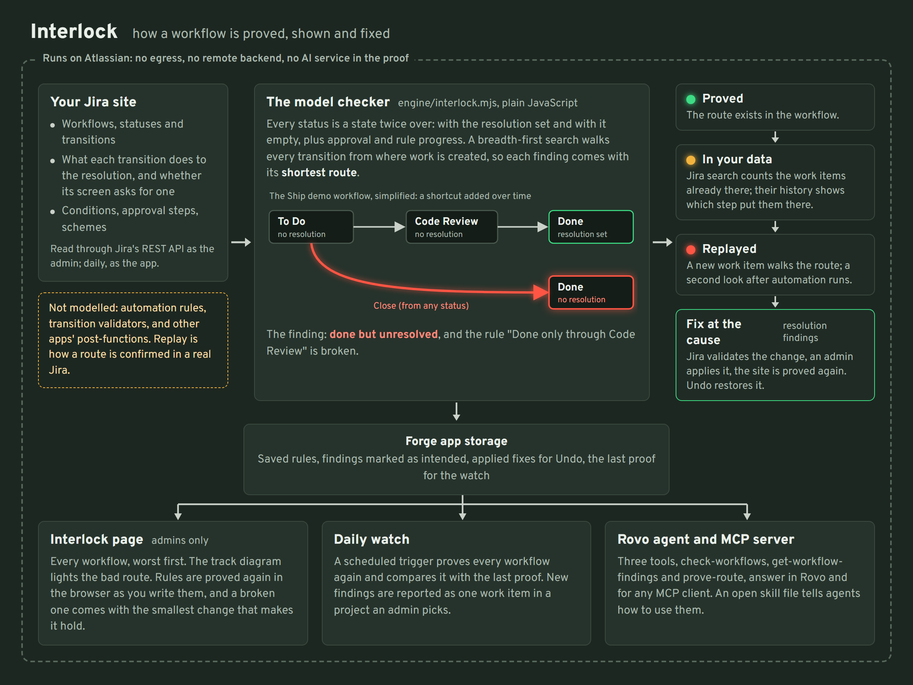

# Interlock

A Jira workflow is a small program. Teams rely on it for promises such as *"nothing is done without code review"*, *"done work is resolved"* and *"nothing gets stuck"*, and Jira itself never checks those promises. A global transition added for a hotfix, a status copied from another project, or a transition screen without the Resolution field quietly breaks them. Dashboards then count finished work as unresolved, or reopened work as resolved, and every filter, gadget and report that runs on the resolution is wrong.

Railway signal boxes solved this a century ago with interlocking: the frame physically prevents a lever combination that would set conflicting routes. Interlock brings the same idea to Jira. Instead of testing a few example work items, it works through every situation a work item can ever be in, meaning each status combined with whether the resolution is set, and checks each promise against all of them. That kind of exhaustive check is called model checking.

It is for Jira administrators and the teams who rely on Jira's numbers: service desks reporting SLAs and change volumes, software teams with review rules, anyone whose release report counts resolved work.



## What it finds

| Property | What it means |
|---|---|
| Work can get stuck | some reachable status has no route to any done status |
| Done but unresolved | a route reaches a done status without setting a resolution, so the work still counts as unresolved |
| Reopened but still resolved | a route leaves a done status without clearing the resolution |
| Status nobody can reach | no route from creation leads to it |
| Transition nobody can use | its conditions allow no user, role, group or permission |
| Route skips a required status | your rule, such as *"work reaches Done only through Code Review"*, does not hold |
| Done without approval | the workflow has an approval step, but a route reaches a successful done status without passing any approval (cancelled, declined and failed outcomes are exempt) |

Each finding comes with the shortest route that breaks the property, from creation, transition by transition.


## Evidence, in three steps

A proof says what *can* happen. Interlock then takes each finding as far as it can go:

1. **Proved.** The model checker found the route.
2. **In your data.** For resolution findings, Interlock counts the work items in the projects using that workflow that are already in the bad state, using Jira's own search. On an Atlassian demo site on Nov 2, 2026, 30 of its 104 workflows had routes that go wrong and 85 work items were already in a wrong state. Those counts include our own Ship demo project and one project made from today's service template; as Atlassian provisioned the site on Nov 1, they were 29 of 97 workflows and 78 work items. The count is split by status, so each finding shows its own items, and **How did they get there?** reads the history of up to 50 of them and counts the step that put each one there: on the procurement project, 46 of the 50 most recently changed came Accepted → Purchased with the resolution left as it was, the very step the proof flagged (once that step is fixed, the page says the items already there are left over from before). Items created or imported in that state, and steps with no author (migrations, scripts), are counted apart, not blamed on a route.
3. **Replayed.** One click creates a new work item and walks it down the route through Jira's transitions API, filling in each transition screen the way a person would. It reads back the status and resolution after every step, and once more a few seconds after the last one, so an automation rule that repairs the resolution shows up and the route is reported safe.

Then **fix at the cause**: for resolution findings, Interlock adds *Set resolution* or *Clear resolution* to the transitions involved. Jira validates the change first, and Interlock saves it only when an admin clicks Apply. The whole site is then proved again. The workflow's card names every project that uses it, because a fix reaches all of them. Undo puts back exactly what was there, and refuses if someone has edited those transitions since.

On that demo site as Atlassian provisioned it, 13 of the 29 workflows with findings are copies of Jira Service Management template workflows; the Change Management workflow has six copies (five in use) with the same five resolution findings (the ENGS copy has a sixth, done without approval), and one was confirmed on a real work item: a declined change sent back to Review stays resolved as Declined. A project created from the same template today does not have that route, so these copies come from an earlier version of the template or were edited after they were made. Either way, nothing in Jira tells an admin which workflows still carry such routes; Interlock does. The full list is in [Resolution defects in template-made workflows](docs/atlassian-templates.md).

**On public Jira sites** anyone can count these, and read the history the way **How did they get there?** does:

- **Apache:** 1,844 done but unresolved and 1,239 open but resolved. 759 of the 1,844 were moved there by 114 different people through transitions that never set a resolution (MXNET In Review → Done, 204 times; HUDI Open → Resolved, 155). Nearly all the rest were created or imported already in that state, so no route is to blame for them.
- **What it does to reports:** in HUDI, an active project, 348 of the 3,401 items its filters call unresolved are finished work (10%). In MXNET, now retired, it was 333 of 1,093 (30%).
- **OpenJDK:** zero, so it can be done.
- **Not routes, and we say so:** on Atlassian's public tracker, 1,065 of its 1,092 done-but-unresolved items were one Sourcetree bulk close in 2019; 379 of Lucene's 380 open-but-resolved items changed with no author, after its move to GitHub.

Details and a script to rerun it: [Resolution defects on public Jira sites](docs/public-jira.md).

## In Jira

**The Interlock page** (Apps → Interlock) is a signal-box mimic panel:

- The lever frame lists every workflow, worst first, with its findings and the work items already affected.
- The track diagram draws the selected workflow. A lit train runs along the bad route.
- The interlocking table lists the findings with their routes, evidence lamps, replay and fix.
- You can write a rule ("work reaches Done only through Code Review") and Interlock proves or refutes it over every route at once, in the browser. A refuted rule comes with the smallest change that makes it hold, itself proved over every route; Interlock suggests it and leaves the edit to the team.

On any site without it, **Add the Ship demo project** builds a seeded demo: a delivery workflow with the shortcuts teams add over time, and 20 work items moved along real routes. Half of its 12 done work items end up unresolved, and the rule *Done only through Code Review* is refuted with the exact route. The demo shows the mechanics; the evidence from real configurations is the [template report](docs/atlassian-templates.md).

**The daily watch** proves every workflow again once a day and compares each proof with the one before, so a workflow edit that opens a bad route shows up as a new finding with the date it appeared. Pick a project under the watch line and new findings are also reported there as a work item.

**Rovo.** The *Workflow interlock* agent answers questions such as *"Can work in Ship reach Done without passing Code Review?"* with a proof or a counterexample route. The same three tools (`check-workflows`, `get-workflow-findings`, `prove-route`) are published as an MCP server, so a coding agent can prove a workflow before and after changing it. [`skills/interlock/SKILL.md`](skills/interlock/SKILL.md) tells an agent how to use them.

**From any MCP client.** An admin turns on *Expose tools to MCP-compatible apps* for Interlock (Atlassian Administration > Apps > Sites > your site > Connected apps), and a client connects to `https://mcp.atlassian.com/forge/<interlock-app-id>` with OAuth 2.1, for example `claude mcp add --transport http interlock https://mcp.atlassian.com/forge/<interlock-app-id>`. [`examples/mcp-client`](examples/mcp-client) is a small client on the official MCP TypeScript SDK; its real output on the demo site, proving the Ship rule:



## How it works



**What the proof covers:** statuses, directed and global transitions, resolution post-functions, transition screens, condition trees (a condition that depends on who is asking counts as passable unless it allows no one) and approval steps. Automation rules, transition validators (Jira's own and other apps') and other apps' post-functions (ScriptRunner, JMWE and the like) are not in the proof, so a route another app already repairs can still show as a finding; when a finding's route runs another app's post-function, Interlock says so on the finding. Replay settles it, because it walks the route through Jira and looks again after automation has run, and an admin can mark any route as intended.


- `engine/interlock.mjs` builds a model from `GET /rest/api/3/workflows/search` with transitions expanded:
  - statuses with their categories;
  - directed and global transitions;
  - each transition's effect on the resolution, from its rules and from whether its transition screen includes the Resolution field;
  - whether its conditions let anyone use it.
- A breadth-first search over (status, resolution set) states finds every reachable state, with parent links, so every finding comes with its shortest route.
- Team-managed projects keep the resolution in step with done statuses themselves, and the model knows that.
- Checking all 104 workflows on that demo site, 824 transitions in all, takes 39 to 127 ms once the configuration is loaded (the page shows the time it took). Loading it over the REST API takes 10 to 20 seconds the first time on a site that size; later checks reuse the transition-screen answers for 10 minutes and take about half as long. The engine is plain JavaScript with no dependencies, and the page runs it again in the browser whenever you change a rule.

## Permissions

Interlock is for Jira administrators, because workflows are site configuration.

| Scope | Why |
|---|---|
| `manage:jira-configuration` | read workflows and statuses; validate and apply a fix |
| `manage:jira-project` | read transition screens (to see which ones set the resolution) and workflow schemes; create the demo project |
| `read:jira-work` | count work items already in a bad state; read transitions during a replay |
| `write:jira-work` | create and move the replay work item and the demo work items |
| `read:jira-user` | read the current user when building the demo project, and check that the caller is a Jira administrator |
| `storage:app` | keep the daily watch's last proof, the team's rules, findings recorded as intended, applied fixes (for Undo) and the list of replay work items |

Interlock changes a workflow only when an admin clicks **Apply** on a fix that Jira has already validated.

**Privacy:** Interlock runs on Atlassian (no egress, no remote backend) and keeps its records only in Forge app storage. See [PRIVACY.md](PRIVACY.md).

## For judges

Install Interlock from [this installation link](https://developer.atlassian.com/console/install/c6e3cd9f-d392-4c9e-b878-c372c23c1c8a?signature=AYABeH%2B9AkQF2VM5qodEsAhbKAcAAAADAAdhd3Mta21zAEthcm46YXdzOmttczp1cy13ZXN0LTI6NzA5NTg3ODM1MjQzOmtleS83MDVlZDY3MC1mNTdjLTQxYjUtOWY5Yi1lM2YyZGNjMTQ2ZTcAuAECAQB4CxqLTo9l4lqXuFjNim1xJM%2Bp%2F3TVP9xHS2BrU5DRRucBn%2BZ61OhkwbJKFAymkDrPxAAAAH4wfAYJKoZIhvcNAQcGoG8wbQIBADBoBgkqhkiG9w0BBwEwHgYJYIZIAWUDBAEuMBEEDIsu%2FZRg4y0sPaRLPwIBEIA7V1C7xWk9JYFZSEl%2FCPaJN23CmKMu2fCaz%2FXAv0GayZthbd7jaUPfHPqxCTMSb%2FDwVedaihWDWJfLUYIAB2F3cy1rbXMAS2Fybjphd3M6a21zOmV1LXdlc3QtMTo3MDk1ODc4MzUyNDM6a2V5LzQ2MzBjZTZiLTAwYzMtNGRlMi04NzdiLTYyN2UyMDYwZTVjYwC4AQICAHi9bVMAkme4qVQX1fQHo6ePw3H40A7cGfz7yrmSfBWMXgG3V3WaugMZ9gAeUz7C687xAAAAfjB8BgkqhkiG9w0BBwagbzBtAgEAMGgGCSqGSIb3DQEHATAeBglghkgBZQMEAS4wEQQMpAjZHMWe8l4qUdd%2FAgEQgDsxmMU1rg90IY3Hco4odbFdty2ZLuQJpgPGUrBEPB1YEWAV%2BqpwoASuU2pcBIJD640c16Cbpo4Jy%2Fy6FQAHYXdzLWttcwBLYXJuOmF3czprbXM6dXMtZWFzdC0xOjcwOTU4NzgzNTI0MzprZXkvNmMxMjBiYTAtNGNkNS00OTg1LWI4MmUtNDBhMDQ5NTJjYzU3ALgBAgIAeDYASx0XCjkny4iLV6vz%2BKtEGSGT6kdt0QRpkn6D%2FlVEAbcGOwtL6HJGuNyi21iNPvUAAAB%2BMHwGCSqGSIb3DQEHBqBvMG0CAQAwaAYJKoZIhvcNAQcBMB4GCWCGSAFlAwQBLjARBAwG6ff%2FrvVY9zDcdWYCARCAO7zouIJ2RsnXUJOaf2bj9SPW398Jqq%2FPTA%2BobqUuEoImilPf1B5JqiCtgJVhkSTDCOC3edfwba8r63YiAgAAAAAMAAAQAAAAAAAAAAAAAAAAAPfZUSPm%2B56hgsg9IOe97pz%2F%2F%2F%2F%2FAAAAAQAAAAAAAAAAAAAAAQAAADKkFDKeCBCS2lkuNO63Eh5xBsx7WxziRrgerJUKHx%2BLrBOUwtahWA9Ib60EQtwrD9YSnN9cy9r%2FgJSYjx1I51AkOzI%3D&product=jira), as a Jira administrator (workflows are site configuration, so the page is shown to admins only). Then:

1. Open **Apps → Interlock**. It reads and proves every workflow on the site; the lever frame on the left lists the ones with findings, worst first. On a site whose projects were made from older templates you may see findings like those in the [template report](docs/atlassian-templates.md); a brand-new site is likely to be clean, so use the Ship demo to see every feature.
2. Select a workflow, then a finding. The track diagram lights the bad route and a train runs along it. The lamps show how far the finding is proven: proved, seen in your data, replayed.
3. Select **Replay on a new work item**. Interlock walks a new work item down the route through Jira and reads back the status and resolution after each step. Delete the item afterwards with the button next to it.
4. On a resolution finding in the Ship demo workflow (not one your teams use), select **Check the fix with Jira**, then **Apply**. The site is proved again and the lamp turns green. **Undo** puts the workflow back.
5. Under **Rules for this workflow**, prove a rule such as *work reaches Done only through Code Review*. If the Ship workflow is not on the site yet, **Add the Ship demo project** first.
6. In Rovo, ask the *Workflow interlock* agent *"Can work in Ship reach Done without passing Code Review?"*

## Build and deploy

```bash
npm install -g @forge/cli     # once; Node 22 or later
forge login
forge register                # gives your copy its own app id
npm install
cd static/panel && npm install && npm run build && cd ../..
forge deploy
forge install
```

`npm run dev` in `static/panel` runs the page in a plain browser against `static/panel/dev/site.json`, a saved copy of a site's workflow search response (not in this repository: save your own). Such a copy has no transition screens, so it shows more findings (81 of 97) than the live site did on the same day (29, Nov 1 snapshot), where screens that ask for a resolution clear many of them.

## Layout

```
manifest.yml            global page, Rovo agent, actions, MCP server
engine/interlock.mjs    the model checker
engine/resolution.mjs   which resolution a transition sets
engine/trace.mjs        "How did they get there?": reads the history of work items in a bad state
src/index.js            site loading, live counts, replay, fix, demo project, daily watch, Rovo actions
static/panel/src/       the signal-box page (React): track diagram (layout.js), interlocking table
skills/interlock/       agent skill for the MCP server
test/                   engine, layout, watch-report and fix tests; test/forge/ stands in for Jira and app storage (npm test)
tools/public-trace.mjs  the public-Jira study (docs/public-jira.md)
docs/                   public-Jira evidence, template report, cover
```
